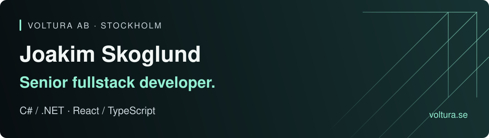
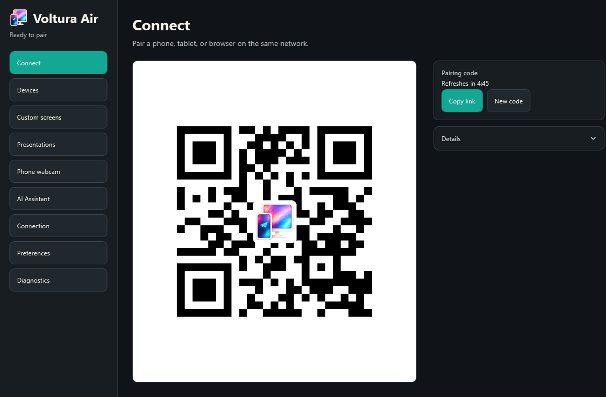
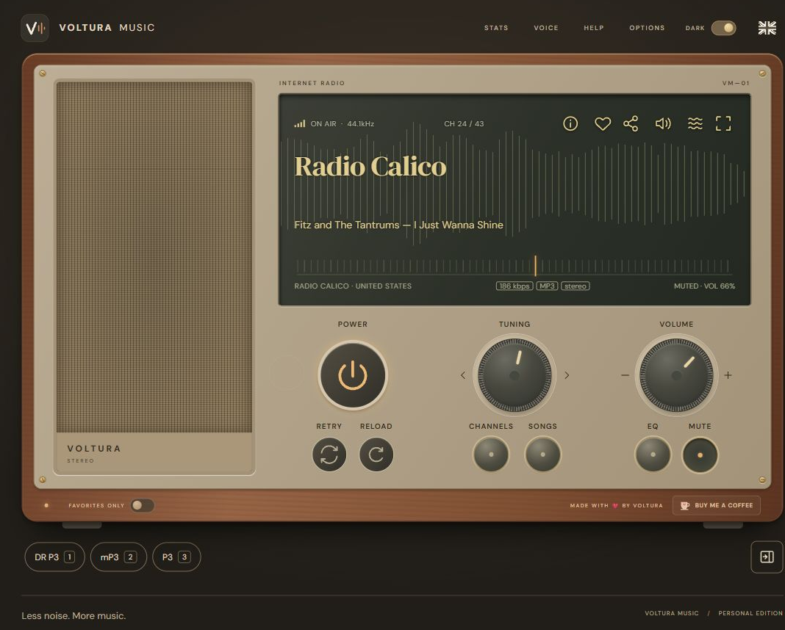
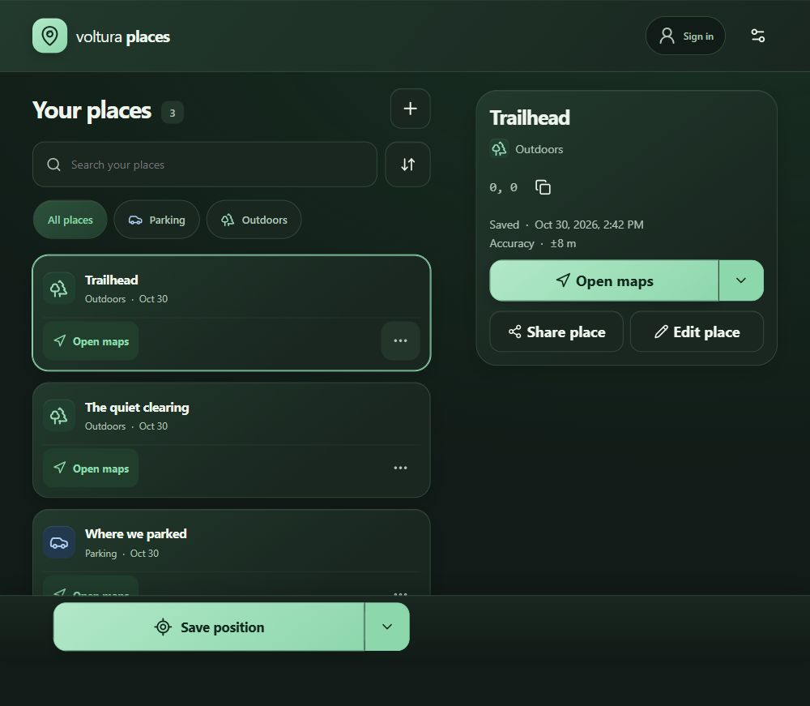
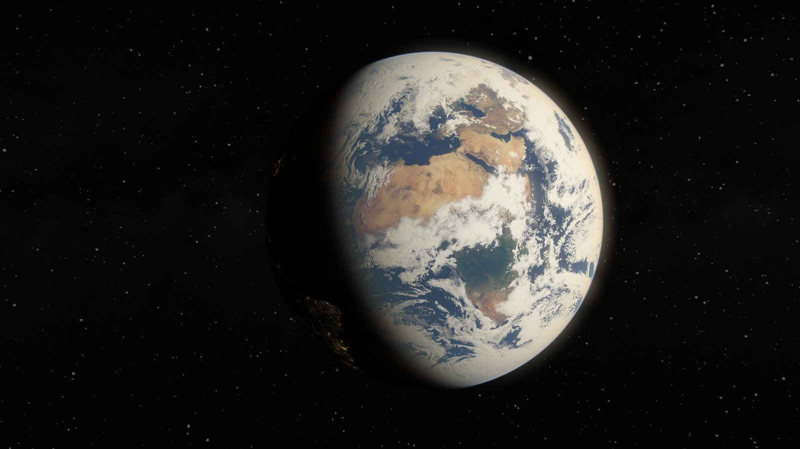

**Independent consultant at Voltura AB · Stockholm, Sweden**

I help teams build business applications, connect systems, and modernize existing software — from requirements through to production. Nearly 30 years in IT, with hands-on experience across telecom, retail, and banking.

**Available for assignments** · [CV & experience](https://voltura.se/#cv) · [LinkedIn](https://www.linkedin.com/in/joakim-voltura/) · [Email me](mailto:joakim@voltura.se)

### What I work with

**C# / .NET · React / TypeScript · SQL Server · REST APIs · System integrations**

Recent client work includes React interfaces, C# APIs, and SQL Server applications at **Tele2**, alongside legacy integrations and Kubernetes deployments. Earlier assignments at **Wincor Nixdorf / Diebold Nixdorf** and **H&M** covered retail, banking, POS, and payment integrations.

### Software I build

Alongside consulting, I build and maintain my own applications. **Voltura Air is my flagship project**, connecting native Windows software with a browser-based companion. My other projects span music, maps, and interactive graphics.

<table>
  <tr>
    <td width="50%" valign="top">
      <h3>Voltura Air</h3>
      
Remote input, live screen viewing, a phone webcam, and file management — connecting Windows with your phone or browser.

      
<a href="https://air.voltura.se/">Explore Air</a> · <a href="https://github.com/voltura/voltura-air">Source</a>

      
    </td>
    <td width="50%" valign="top">
      <h3>Voltura Music</h3>
      
Worldwide radio for desktop and mobile, with visualizations, audio controls, and synced favorites.

      
<a href="https://music.voltura.se/">Listen to Music</a>

      
    </td>
  </tr>
  <tr>
    <td width="50%" valign="top">
      <h3>Voltura Places</h3>
      
Save places and record routes. Offline-first, with optional account sync and group sharing.

      
<a href="https://places.voltura.se/">Open app</a> · <a href="https://github.com/voltura/voltura-places">Source</a>

      
    </td>
    <td width="50%" valign="top">
      <h3>Voltura Worlds</h3>
      
Animated worlds for Windows, from auroras to the Solar System. Native C++ and Direct3D 12.

      
<a href="https://worlds.voltura.se/">Explore Worlds</a> · <a href="https://github.com/voltura/voltura-worlds">Source</a>

      
    </td>
  </tr>
</table>

### More from Voltura

| Project | What it does |
| :--- | :--- |
| [Markdown](https://github.com/voltura/voltura-markdown) | A compact Windows Markdown reader and editor with live preview. |
| [WeekNumber](https://github.com/voltura/voltura-weeknumber) | Week numbers, a calendar, and date tools beside the Windows clock. |
| [Earner](https://github.com/voltura/voltura-earner) | Work hours, earnings, overtime, and Excel reports. |
| [Books](https://github.com/voltura/voltura-books) | Browse and read books and documents, and send books to Kindle. |

---

**Have an assignment in mind?** [Let’s talk](mailto:joakim@voltura.se) · [voltura.se](https://voltura.se/)
